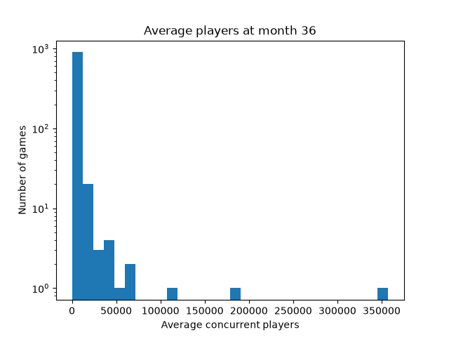
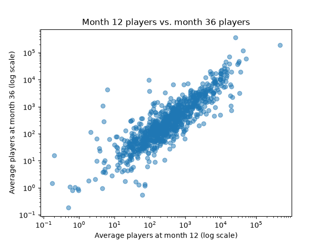
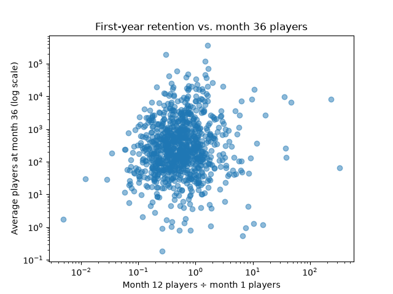

# Model Report

## Data Exploration

Three charts were made to explore the train data before building any models.

### Average players at month 36 histogram.

The target is heavily right-skewed: most games have few players by year 3, while a small number of hits remain large

### Month 12 players vs. month 36 players scatterplot

There is a strong positive relationship between these two values; games that are big at the end of year 1 tend to stay big through year 3.

### First year retention vs. month 36 scatterplot

Most games keep less than their launch audience at the end of year 1, and first year retention alone looks like a weak predictor of the target (likely because it ignores scale).

## Error measure and baseline

Model success is compared using mean absolute error (MAE). This is the average number of players each prediction is off by. Due to the right skew of the data, misses on the large games weigh more heavily on the MAE than on the small games. This means that the MAE reflects more on how well the models are able to predict the larger games in the data. 

The baseline does not use a model. Rather, it predicts the train data average on every validate game. Its validate MAE is 3,511 players, meaning that a model must score lower than 3,511 to be worth using.

## Model Comparison

Three models were built on the train data and scored on the validate data.
* Linear regression
* Random forest
* K Nearest Neighbors

| Model | Validate MAE | Better than baseline? |
|---|---|---|
| Baseline (train average) | 3511 | - |
| Linear regression | 4790 | No |
| Random forest | 2266 | Yes |
| KNN | 2725 | Yes |

The linear regression model did worse than the baseline, likely due to the skewed data. The KNN model and random forest model both did better than the baseline, but ultimately, the random forest model was chosen, as it had the lowest validate MAE.

## Test Results

The model was trained on games released prior to 2020, validated on games from 2020 and 2021, and tested on games released 2022 and later.

| Model |  MAE |
|---|---|
| Random forest, validate | 2266 | 
| Random forest, test | 2749 | 

The test MAE was higher than the validate MAE. This is expected due to the time frame: test games were temporally further away from the train data than validate, and the video gaming market changed in that time. Additionally, the test data is a smaller set and more impacted by large games.

## What the Model Learned

| Rank | Feature | Importance |
|---|---|---|
| 1 | month12_avg_players | 0.65 |
| 2 | m1_to_m12_retention | 0.10  |
| 3 | release_year | 0.06 |
| 4 | month1_avg_players | 0.05 |
| 5 | m1_peak_m1_avg_ratio | 0.04 |

**In business terms:** The strongest signal by far for a game's year 3 average players is its average players at the end of year 1 (`month12_avg_players`), dwarfing every other signal. The first-year retention also adds to the signal (`m1_to_m12_retention`), and launch size (`month1_avg_players`) and launch spikiness (`m1_peak_m1_avg_ratio`) add a little more. Release year matters somewhat, likely due to changes in the Steam market over time. Surprisingly, the user tags and price barely matter to the model; player history seems to be the important signal. It's also worth noting that these features show what the model relies on, not what causes players to stay.

## Limits

* The sample is the top 2,000 games by owners, so it skews towards successful games.
* Early Access can distort the time variables.
* There is no data on updates, marketing campaigns, etc, which are likely big drivers.
* Concurrent players are not sales; Steam does not publish sales data.

The data that would help most would be information on timing of updates and add-on/DLC releases and a larger sample that includes less successful games.